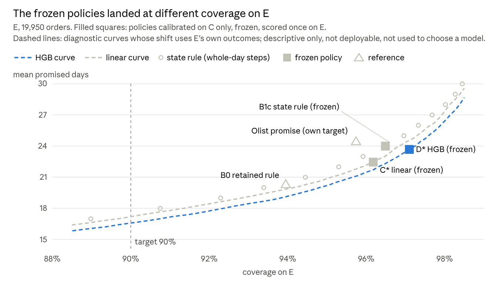

# Promised delivery dates on Olist: when is a matched comparison still unequal?

A pre-registered study on public Olist e-commerce orders (Brazil, 2017–2018). It compares a per-state quantile rule, a
linear quantile regression and a shallow gradient-boosted model (HGB) as ways to set a whole-day promised delivery date
with 90% target coverage.

I trace how prediction, calibration and rounding combine to set a delivery promise, and test whether added model
complexity earns its place. E1 is pre-registered exploratory research: its evaluation period had already been examined
in an earlier project stage.

**Interactive page: [suzanneisgenius.github.io/olist-delivery-promises](https://suzanneisgenius.github.io/olist-delivery-promises/)**.
Explore risk prioritisation, probability calibration and promised-date comparisons, then work through the mathematics
with interactive examples ([source and checks](docs/diagnostics_page/)). Views 01–03 use saved project outputs;
view 04 connects them to illustrative calculations and seeded simulations.



*Filled squares: policies calibrated on Oct–Dec 2017 only, frozen, scored once on Apr–Jul 2018. Dashed lines: post-hoc
diagnostic curves that use the evaluation outcomes; not deployable, not used to choose a model.*

## My contribution

I built this project around a question I wanted to answer: when does a better forecast actually produce a better
delivery promise? I designed the study, wrote the preregistration, and implemented the scoring code, tests, and
simulations. Across successive revisions, I initiated each review and decided which findings required a change to
the code, the comparison, or the conclusions.

I also led the work that turned the research into a portfolio dashboard, including the verification workflow,
diagnostic page, and release preparation. The E2b protocol remains a draft for future work.

Claude assisted with selected code refinements and initial drafts of supporting documentation.
See [AUTHORSHIP.md](AUTHORSHIP.md) for details.

## Research question and findings

| Question | Answer |
|---|---|
| What does the study ask? | Does lower forecast loss lead to shorter promised dates at comparable reliability, and does regression improve on a simple per-state rule? |
| What did the comparison show? | Matching the comparison reversed the regression-versus-rule result (+2.57 → −1.54 days). Also, HGB had lower loss, yet its frozen policy promised 1.22 more days: it reached 97.1% coverage against 96.2%, so the two points were not at the same reliability. |
| What remains unresolved? | Why every calibrated policy over-covers the evaluation period (96–97% for a 90% target): changing delivery times, the cohort filter on Olist's estimated date, or order mix. Whether rounding down or recalibration would hold up in a new period, and whether the results extend beyond single-seller delivered orders, remain untested. |

**Result interpretation.** H3's one-day threshold result applies to the registered round-up rule.
[`docs/E1_WORDING_CORRECTIONS_2026-10-27.md`](docs/E1_WORDING_CORRECTIONS_2026-10-27.md) records this distinction and
subsequent audit findings alongside the unchanged sealed reports.

## Start here

| File | What it is |
|---|---|
| [`documents/current/E1_main_report.pdf`](documents/current/E1_main_report.pdf) | Main report (7 pages): question, design, results, limits |
| [`documents/current/E1_math_note_en.pdf`](documents/current/E1_math_note_en.pdf) ([中文](documents/current/E1_math_note_zh.pdf)) | Mathematical note (3 pages): why a quantile; what k/n, k/(n+1) and evaluation coverage each show; whole-day rounding |
| [`notebooks/e1_by_hand.ipynb`](notebooks/e1_by_hand.ipynb) | Four small checks by hand: loss enumeration, hand calibration, rounding cases, one recomputed result |
| [`documents/current/E1_supplement.pdf`](documents/current/E1_supplement.pdf) | Model selection, simulation, post-hoc sensitivity tables, integrity record, contribution statement |

Run the checks (no raw data needed); rerunning the whole study from the raw Kaggle CSVs is described in `docs/REPRODUCE_E1.md`:

```bash
pip install -r requirements-e1-tested.txt
bash AGENT_REVIEW/verify_all.sh        # 11 checks: hashes, 362 tests, 26 numerical claims
pip install notebook && cd notebooks && jupyter notebook e1_by_hand.ipynb   # optional
```

**Reading paths.** Statistics: research question (main report §1) → main figure (§4) → mathematical note → limits
(§6) → [authorship statement](AUTHORSHIP.md). Data science and analytics: the business trade-off between late orders
and waiting time (§1–2) → data contract and quality checks (`config/data_contract.yaml`,
`outputs/stage1_quality_report.md`) → time-safe modelling, with labels used only once delivered and models frozen
before evaluation (§3, `docs/E1_DECISIONS.md`) → days promised against coverage (§4–5) → one-command checks and the
end-to-end rerun (`docs/REPRODUCE_E1.md`, `outputs/e1/recipeB_acceptance/`).

## Process and integrity

- **Registered state.** Config v3 SHA-256 `ae6a4a46…20152`; freeze record `outputs/e1/freeze/FREEZE.json`, SHA-256
  `3b62af1a…328dd`, unchanged since it was written; scoring-time code in `snapshots/src_at_e1_scoring/`.
- **Checks.** 362 automated tests pass. The verifier checks 26 numerical claims against saved evidence, recomputing
  metrics from saved per-order files where available and otherwise comparing saved aggregates. Reproduction recipes B
  (historical code) and C (current code) were run end to end from raw CSVs and matched the saved results.
- **Records.** Plan changes: `docs/E1_DECISIONS.md`. Post-hoc analyses: `docs/E1_POSTHOC_METHODS_REVIEW.md`. Final
  fixes: `docs/E1_FINAL_FIXES_2026-10-21.md`. Wording corrections after sealing:
  `docs/E1_WORDING_CORRECTIONS_2026-10-27.md`. Earlier review rounds: `AGENT_REVIEW/PRIOR_REVIEWS.md`.
- **Next research questions.** Test a new evaluation period and a cohort selected independently of Olist's estimated
  date. E2a (`docs/E2A_PROTOCOL_DRAFT.md`) and E2b (`docs/E2B_PROTOCOL_DRAFT.md`) remain unregistered, unrun drafts.
- **Archive.** Earlier report versions: `documents/archive/`. The pipeline README for stages 1–7 (v0.6.3,
  byte-identical to the copy listed in `release/MANIFEST.sha256`): `docs/archive/README_pipeline_v0.6.3.md`.

Independent public-data portfolio project, unaffiliated with Olist.
